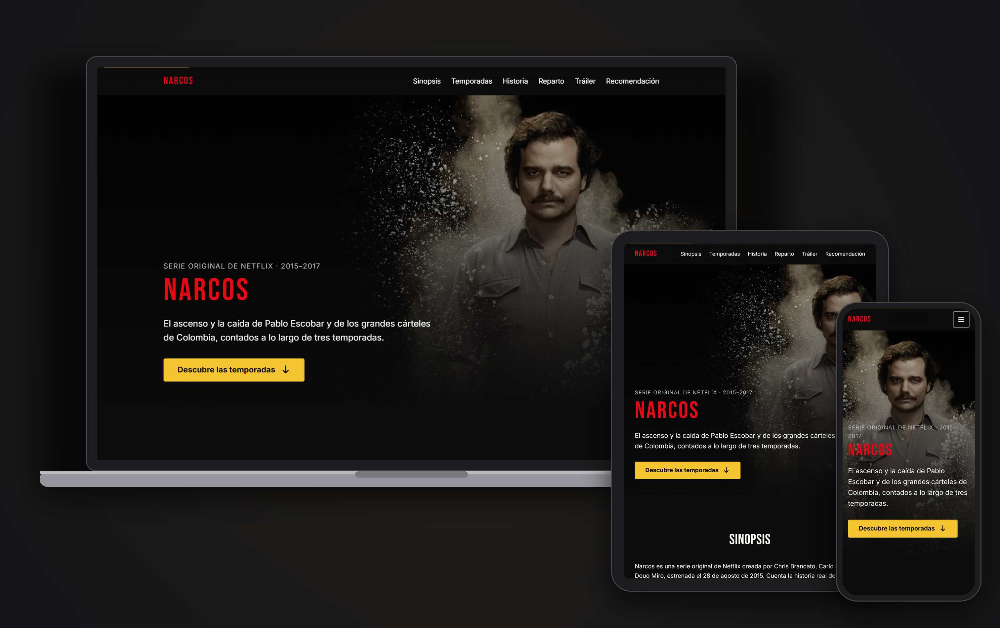

<p align="center">
  
</p>

<h1 align="center">Narcos · Web de fans</h1>

<p align="center">
  Landing page de fans de la serie <strong>Narcos</strong>, creada para la PEC 1 de <em>Herramientas HTML y CSS II</em> (UOC).
</p>

<p align="center">
  
  
  
  
</p>

## Secciones

Página única con navegación por anclas:

1. **Hero**: imagen a pantalla completa, con recorte distinto en móvil, y llamada a la acción. Incluye una entrada cinematográfica: fundido desde negro, zoom de la imagen y aparición escalonada de los textos.
2. **Sinopsis**: resumen de la serie y ficha técnica, junto a un expediente clasificado de la DEA que el usuario puede desclasificar.
3. **Temporadas**: tarjetas de las tres temporadas.
4. **Importancia histórica**: línea de tiempo con los hechos reales.
5. **Reparto principal**: tarjetas con actor y personaje.
6. **Tráiler**: vídeo de YouTube (`youtube-nocookie`) incrustado de forma responsive. Debajo, un reproductor de la sintonía «Tuyo» que solo se carga a petición.
7. **Cita**: bloque destacado entre el tráiler y los motivos, sin ancla propia en la navegación, con una frase elegida al azar entre varias frases célebres de la serie.
8. **Por qué verla**: cinco motivos con iconos.
9. **Footer**: enlaces a las secciones y recursos externos.

## Funcionalidades

- **Diseño responsive mobile-first**, con breakpoints `sm`, `md`, `lg` y `xl` gestionados por el mixin `mq()`.
- **Navbar fija** que cambia de estilo al hacer scroll y se convierte en un menú hamburguesa en móvil. El menú se cierra con `Escape` o al pulsar un enlace.
- **Animaciones al hacer scroll** con [AOS](https://michalsnik.github.io/aos/), desactivadas si el usuario tiene activado `prefers-reduced-motion`.
- **Imágenes optimizadas**: WebP generado con `sharp`, `srcset`/`sizes` para servir el tamaño adecuado y `loading="lazy"` en las que quedan fuera de la primera pantalla.
- **Fuentes autoalojadas** (Bebas Neue e Inter vía Fontsource), cargando solo el subconjunto latino y los pesos que se usan.
- **Iconos** de Font Awesome.
- **Expediente clasificado**: los datos del objetivo (Pablo Escobar), los agentes asignados y la misión aparecen tachados con barras de censura. En cada recarga se usa un método distinto para desclasificarlos, rotando entre los tres en este orden (se recuerda el último con `localStorage`):
  - **Rascador**: un `canvas` sobre cada barra que se rasca con el ratón o el dedo; el dato se revela al rascar más del 70 %.
  - **Borrar al pasar**: la barra se recoge al pasar el cursor o el dedo, en la dirección por la que entra el gesto.
  - **Linterna UV**: una luz sigue al puntero y deja ver lo censurado; cada dato queda fijado cuando la luz ha pasado por todo él. Se omite si el navegador no soporta `mask-image`.

  Al desclasificarlo todo, el sello cambia de «Clasificado» a «Desclasificado» con una animación. El botón «Revelar todo» lo muestra de una vez y después permite volver a clasificar el expediente sin recargar.

- **Frases célebres aleatorias**: se cargan desde `src/assets/data/quotes.json`, cambian en cada recarga sin repetir la anterior (`sessionStorage`) y el botón «Otra frase» muestra otra con un fundido.
- **Sintonía bajo demanda**: el `iframe` de YouTube no se crea hasta pulsar «Escuchar la sintonía», y al cerrarlo se elimina del DOM para detener el audio.

## Accesibilidad

- HTML semántico (`header`, `nav`, `main`, `section`, `article`, `blockquote`, `dl`) y secciones enlazadas a su título con `aria-labelledby`.
- Enlace para saltar al contenido (_skip link_) y un anillo de foco visible.
- Menú móvil con `aria-expanded` y etiqueta accesible.
- Paleta oscura con contraste WCAG 2.1 AA y abreviaturas marcadas con `<abbr>`.
- Efectos `hover` solo en dispositivos con puntero.
- Las animaciones de la entrada del hero, del sello del expediente y del cambio de frase se desactivan con `prefers-reduced-motion`.
- Los cambios de estado del expediente y de la frase se anuncian con regiones `aria-live`, y el expediente siempre se puede desclasificar con el botón, sin depender del gesto.
- El foco se conserva al abrir y cerrar el reproductor de la sintonía y al cambiar la función del botón del expediente.
- Sin JavaScript, los datos del expediente se muestran sin censura, la frase inicial queda en el HTML y la sintonía se ofrece como enlace a YouTube.

## Estructura

```
src/
├── index.html              # Esqueleto de la página; incluye los parciales
├── views/                  # Una sección por parcial (posthtml-include)
└── assets/
    ├── data/
    │   └── quotes.json     # Frases célebres de la serie
    ├── images/             # Imágenes originales (sharp genera las variantes)
    ├── favicon/
    ├── scripts/
    │   ├── main.js         # Dependencias, AOS e inicialización
    │   ├── navbar.js       # Scroll y menú móvil
    │   ├── dossier.js      # Expediente: elección del método, sello y botón
    │   ├── dossier-uv.js       # Método de la linterna UV
    │   ├── dossier-scratch.js  # Método del rascador
    │   ├── dossier-swipe.js    # Método de borrar al pasar
    │   ├── quote.js        # Frase aleatoria
    │   └── theme-song.js   # Reproductor de la sintonía
    └── styles/
        ├── main.scss       # Solo importa parciales
        ├── abstracts/      # Variables, funciones y mixins
        ├── base/           # Reset, tipografía y utilidades
        ├── layout/         # Contenedor y secciones
        └── components/     # Un parcial por componente
```

## Criterios

- **Sass modular** con `@use` y una organización inspirada en el patrón 7-1, simplificada en `abstracts`, `base`, `layout` y `components`.
- **BEM** para nombrar las clases (`bloque__elemento--modificador`), validado con `stylelint-selector-bem-pattern`.
- **Design tokens** en `_variables.scss` (colores, fuentes, breakpoints, capas de `z-index` y espaciado), a los que se accede mediante funciones como `color()`.
- **HTML dividido en parciales** para que cada sección se pueda mantener por separado.
- **JavaScript mínimo**, como mejora progresiva: la clase `no-js` se sustituye por `js` al cargar, y la página sigue funcionando sin scripts.
- **Métodos del expediente intercambiables**: cada uno vive en su propio módulo con la misma interfaz (`{ id, hint, supported, mount }`), y `mount()` devuelve `{ stop, restart, revealAll }`, de modo que `dossier.js` los gestiona sin conocer sus detalles.
- **Almacenamiento tolerante a fallos**: los accesos a `localStorage` y `sessionStorage` van en `try/catch`; si no están disponibles, la elección es aleatoria sin memoria entre recargas.

## Uso

Requiere Node.js >= 20.19. La versión fijada en `.nvmrc` es la v22.23.4, a la que se actualizó porque corrige la vulnerabilidad CVE-2026-111497. Proyecto basado en [UOC Boilerplate 3.x](https://github.com/uoc-advanced-html-css/uoc-boilerplate) (Parcel v2).

```bash
npm install       # instalar dependencias
npm run dev       # servidor de desarrollo en http://localhost:8123
npm run build     # build de producción en dist/
npm run lint:css  # revisar los estilos con Stylelint
```

## Autor

**Rafael Larrea**: PEC 1 de _Herramientas HTML y CSS II_, Máster Universitario en Desarrollo de Sitios y Aplicaciones Web (UOC).

## Licencia

El código se distribuye bajo licencia [MIT](LICENSE), igual que el UOC Boilerplate en el que se basa.

_Narcos_ y todas sus imágenes y marcas pertenecen a Netflix y a sus respectivos titulares. Se usan aquí solo con fines educativos, en un proyecto sin ánimo de lucro.
